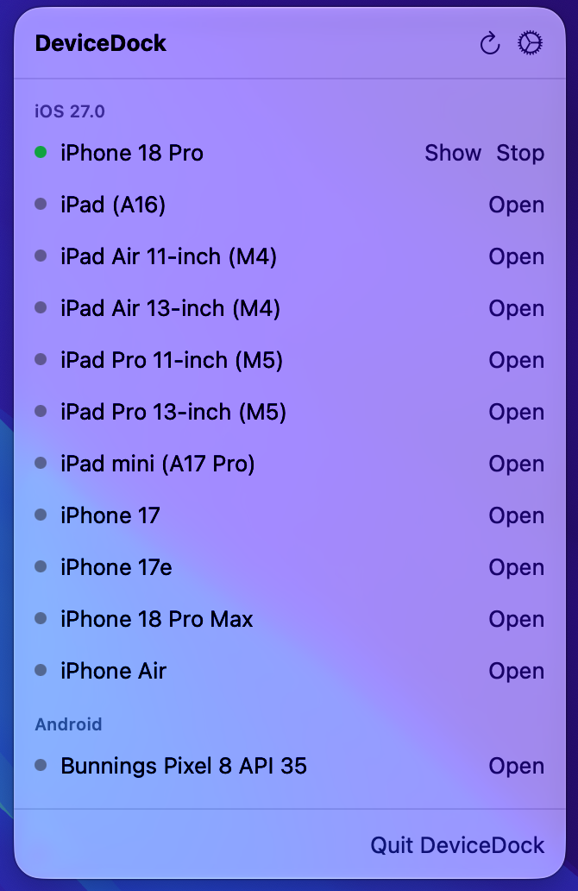

# DeviceDock

[](https://github.com/AhsanT4riq/DeviceDock/actions/workflows/build.yml)

A macOS menu bar app for mobile developers: see all your iOS simulators and Android emulators in one place, start several at once, and stop them with one click.



## Features

- Lists iOS simulators (grouped by iOS version) and Android emulators (AVDs)
- **Open** boots a device, and you can run several at the same time
- **Stop** shuts a running device down, and **Show** brings DeviceHub to the front
- Status dots: 🟢 running · 🟠 booting · ⚪ stopped, with running devices sorted to the top
- Refreshes automatically, so devices started elsewhere show up too
- Lives only in the menu bar, with no Dock icon

## Requirements

- macOS 14 Sonoma or later
- Xcode with at least one iOS simulator runtime (for iOS)
- Android SDK with at least one AVD (optional, for Android)

## Install

1. Download `DeviceDock.zip` from the [Releases](../../releases) page and unzip it.
2. Move `DeviceDock.app` to `/Applications` and open it. An iPhone icon appears in the menu bar.

DeviceDock is signed with a Developer ID and notarized by Apple, so it opens without Gatekeeper warnings.

### Build from source

```bash
git clone https://github.com/AhsanT4riq/DeviceDock.git
cd DeviceDock
open DeviceDock.xcodeproj   # then press ⌘R
```

## Android SDK location

DeviceDock looks for the SDK in this order:

1. The path set in **Settings** (the gear icon), if any
2. `ANDROID_HOME`
3. `ANDROID_SDK_ROOT`
4. `~/Library/Android/sdk` (Android Studio's default)

Apps opened from Finder don't see your shell's environment variables, so if your SDK is somewhere unusual, set it in Settings.

## How it works

DeviceDock runs the same command-line tools you would:

| Action | iOS | Android |
| --- | --- | --- |
| List | `xcrun simctl list devices available -j` | `emulator -list-avds` + `adb devices` |
| Open | `xcrun simctl boot <udid>` + open DeviceHub | `emulator -avd <name>` |
| Stop | `xcrun simctl shutdown <udid>` | `adb -s <serial> emu kill` |

That's why the app isn't sandboxed and isn't on the Mac App Store: sandboxed apps can't launch these tools. It's distributed directly, signed and notarized instead.

## License

[MIT](LICENSE) © 2026 Ahsan Tariq
